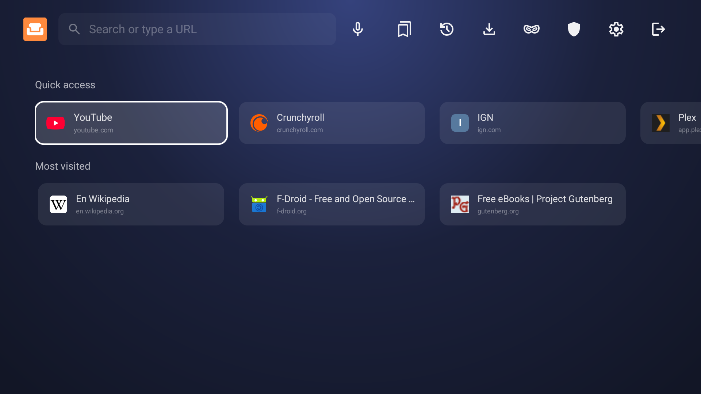

# Sofa TV Browser

A small, private web browser for Android TV and Google TV, made to be used with the remote. On the TV it is
called Sofa.



- **A mouse pointer on the D-pad**, with hover, drag, and scrolling by pushing against the screen edge.
- **Game pads** (Xbox, PlayStation, 8BitDo and others): the left stick moves the pointer, the right stick scrolls,
  and the buttons work as in a console browser. Settings → Game controller shows them all.
- **A menu on the Back key**: address, Watch, back and forward, find in page, bookmarks, history, zoom, ad
  blocking per site, and "Browse as" desktop, mobile or TV.
- **A home screen** with your own tiles, your most visited sites and your bookmarks.
- **Watch**: one press of Play finds the page's main video and plays it fullscreen.
- **Sofa Player**: in fullscreen, Sofa plays the site's stream in its own player when it can, with 4K at full
  resolution, HDR, and a choice of quality, sound and subtitles. Otherwise the site's player carries on.
- **Controls for fullscreen video**: seek, pause, playback speed, subtitles, Video info, picture-in-picture, and
  Play in another app (Android asks once, Sofa remembers; hold OK on the button, or use Settings → Play in…, to
  choose again or to be asked every time).
- **Match frame rate** (experimental), on TVs that offer it: films play at 24 Hz instead of juddering at 60.
- **Ad blocking with filter lists** in the formats of uBlock Origin, Adblock Plus and hosts files, including
  hiding the empty boxes ads leave behind. One switch adds EasyList and EasyPrivacy.
- **Pop-ups blocked**, even from ad networks no list knows yet, with "Allow once" in the menu when you need one.
- **Search** with the engine you choose at first start, and voice search.
- **Downloads** that pause, resume and carry on in the background.
- **Dark and Light themes.**

The app is about 2 MB.

## Install

Download `sofa-<version>.apk` from the [latest release](https://github.com/sonalder-darlene/sofa-tv-browser/releases/latest)
and install it on the TV, for example with a file manager app or `adb install`. Sofa needs Android 7.0 or newer.

If Play Protect says "App blocked to protect your device", choose **More details → Install anyway**. It says this
about apps from developers it hasn't seen before.

## Updates

Sofa can check GitHub for new versions. It asks at first start, and you can change your answer in Settings →
Updates. It checks at most once a day, and nothing installs without your confirmation.

Copies installed by an app store or by Obtainium never offer this; the store keeps them up to date.

## Privacy

- **Nothing of its own:** no accounts, analytics, ads, crash reports or servers. Apart from the sites you visit,
  Sofa only contacts your search engine (for suggestions, if you turn them on), GitHub (for update checks, if
  you turn them on) and the addresses of your filter lists (when you add or update them, or every few days if you
  turn on automatic updates). Voice search uses the TV's speech service.
- **Blocking:** ads and trackers are blocked on the TV (see [Ad blocking](#ad-blocking)), and third-party cookies
  are blocked too.
- **Blending in:** few browsers send Do Not Track and desktop Chrome is the most common browser, so Sofa sends no
  Do Not Track and uses a desktop Chrome user agent by default. Global Privacy Control can be turned on in Settings.
- **Pages get nothing extra:** no camera, microphone, location or files.
- **Private browsing** uses a separate WebView profile that is deleted afterwards. On TVs whose WebView is too old
  for that, it keeps no history and erases site data when it ends.
  A video handed to another app (Play in…) may stay in that app's own history, which Sofa can't erase.
- **History** is kept for as long as you choose: 7, 30 or 90 days (the default), always or never.
- **WebView reporting:** usage reports to Google are off, and so are Safe Browsing lookups unless you turn them on.

## Ad blocking

Everything is matched on the TV; nothing about your browsing leaves it.

- **Filter lists:** the StevenBlack hosts list (about 71,000 domains) and HaGeZi's Pop-Up Ads list (about 48,000) come
  with Sofa. **Stronger ad blocking** in Settings adds EasyList and EasyPrivacy, about 145,000 more rules, for TVs
  with a few MB of memory to spare. Settings → Filter lists takes any other list by its address, in hosts, Adblock
  Plus or uBlock Origin format, and switches each list on or off.
- **Element hiding** removes the empty boxes and banners that blocked ads leave, also when a page adds them later.
- **Pop-ups:** with one view and no tabs, a pop-up would replace the page you were on. Sofa blocks windows a page
  opens without a press, windows to listed ad sites, windows a script opens to another site when you didn't press a
  link to it, and the invisible links pop-under networks lay over a page. Pages that send you to a listed ad site
  on their own are stopped too. The menu's "Allow once" opens the last thing blocked.
- **Updates:** lists are downloaded when you add or update them, without cookies. Sofa can also update them every
  few days by itself; it asks at first start, and EasyList and EasyPrivacy, which change every few days, are best
  kept that way.
- **Per site:** the Ad block button in the menu switches all of this off for one site and shows how much was
  blocked on the page.

## Video

- **Sofa Player:** once a video plays fullscreen, Sofa looks for the stream behind it: a video file, or an HLS or
  DASH stream the page loaded. If it can play it, Sofa Player (AndroidX Media3) gets ready out of sight and takes
  over at the same position. It draws on a video layer of its own, so a 4K stream reaches a 4K panel at full
  resolution, in HDR when the stream and the TV have it. "Quality, sound and subtitles" on the bar lists what the
  stream offers, and Video info shows the decoder and the frames dropped. When the stream has no subtitles of its
  own, the page's subtitle files are offered instead, and the one the site was showing stays on. If Sofa Player only
  gets a software decoder while the TV has a hardware one for the video (the site's player may still hold it), it
  pauses the site's video and tries once more before taking over. Its requests are the ones the page's
  player would make, with the same headers and cookies, and it keeps no cache. Protected (DRM) video, videos under
  a minute and streams a page builds itself (YouTube's, for one) stay with the site's player.
- **Back to the site's player:** the bar's "Site's player" button switches back at the same position, and so does
  Sofa if its player can't go on. Settings → Sofa Player turns it off.
- **Another app instead:** Settings → "Always play in another app" (experimental, off by default) sends fullscreen
  videos to the "Play in…" app instead of Sofa Player. Protected videos and videos under a minute stay in Sofa.
  How well a video plays there depends on the app and the site, which is why Sofa never does this unless asked.
- **Decoding:** with the site's player, the TV's web engine (Android System WebView) decodes the video, with the
  TV's video hardware where the format allows; Video info shows what the TV reports. Sofa's fullscreen controls are
  drawn on top of the picture.
- **4K with the site's player:** in fullscreen, sites see the TV's real resolution, so on a 4K TV they can send
  their 4K stream. The web engine then shows it through Sofa's HD window, as it does for every app, so the panel
  gets an upscaled HD picture; it is still sharper than the site's HD stream.
- **Frame rate:** with Settings → Match frame rate (experimental, off by default), the TV switches to the video's frame rate in
  fullscreen, such as 24 or 50 per second, and back afterwards. Sofa measures the rate from the frames the page
  shows (Sofa Player reads it from the stream), and only switches between refresh rates the TV offers at its current resolution. The screen goes dark for
  a moment while the TV switches, so videos under 5 minutes are left alone. The setting only appears on TVs that
  offer more than one refresh rate, and Android 12's "Match content frame rate: Never" turns it off.
- **Resolution:** Sofa never changes the TV's resolution. Web video always reaches the screen through Sofa's
  window, so switching the output to the video's resolution would only move the scaling elsewhere.
- **Protected (DRM) video** plays in standard definition on most TVs: the web engine only offers software
  protection, and streaming services keep HD for hardware protection. Sofa asks each site first, and Settings →
  Protected content can allow or block it everywhere.
- **The screen stays on** while a video plays, and long films offer to continue where you stopped.

## Not there yet

Tabs, reader mode, typing from a phone, translations, and user scripts (planned: [docs/user-scripts.md](docs/user-scripts.md)).

## For developers

**Build**

```sh
nix develop -c ./gradlew assembleStandardRelease   # app/build/outputs/apk/standard/release/
nix develop -c ./gradlew testStandardDebugUnitTest testPlayDebugUnitTest lintStandardDebug lintPlayDebug
```

Without Nix, use JDK 17 or newer and an Android SDK with platform 36 and build-tools 36.1.0 in `ANDROID_HOME`.
The project uses AGP 9.4.1, Kotlin 2.4.21 and Gradle 9.8.1. The UI is plain framework views; the
dependencies are `androidx.webkit` and Media3 (ExoPlayer with HLS and DASH) for Sofa Player.

**Two builds**

- `standard` is for GitHub releases, F-Droid and other stores. Its opt-in updater (`app/src/standard/`) stays
  hidden when an app store installed Sofa or when the APK isn't signed with the release key. A fork can point it at
  its own releases with `-Psofa.updateUrl=https://api.github.com/repos/<owner>/<repo>/releases/latest` and
  `-Psofa.releaseCert=<sha-256>`.
- `play` is for Google Play, which forbids apps that update themselves. It has no updater
  (`./gradlew bundlePlayRelease`).

**Signing**

Official APKs are signed with this certificate (SHA-256):

```
74:E2:3F:09:BB:4B:01:16:00:C3:8E:7D:55:5F:B3:89:26:AC:C3:83:50:29:B7:FC:02:E4:84:66:C3:4C:8A:A9
```

Check a download with `apksigner verify --print-certs`. Release builds are reproducible: building a release tag
gives the same APK contents.

To sign your own builds, put a `keystore.properties` with `storeFile`, `storePassword`, `keyAlias` and
`keyPassword` at the repository root (it is gitignored), or set `SOFA_KEYSTORE_FILE`, `SOFA_KEYSTORE_PASSWORD`,
`SOFA_KEY_ALIAS` and `SOFA_KEY_PASSWORD`. Without them, release builds use the debug key.

**Releasing**

1. Set `versionName` and `versionCode` (MAJOR × 10000 + MINOR × 100 + PATCH) in `app/build.gradle.kts`.
2. Add the changes to `CHANGELOG.md` and to `fastlane/metadata/android/en-US/changelogs/<versionCode>.txt`
   (500 characters at most).
3. Commit, tag `v<version>`, and build `assembleStandardRelease` from a clean checkout of the tag. The APK records
   its commit, so it must be built from exactly the tagged one.
4. Push, then attach the APK to a GitHub release as `sofa-<version>.apk`. The updater looks for that name and shows
   the first 700 characters of the release notes.

**Testing**

`nix develop .#emulator` provides `adb` and an Android TV 14 emulator:

```sh
avdmanager create avd -n sofatv -k "system-images;android-34;android-tv;x86" -d tv_1080p
"$ANDROID_HOME/emulator/emulator" -avd sofatv
```

On a TV, turn on network debugging, then run `adb connect <tv-ip>:5555` and `adb install -r <apk>`.
`adb install -i <store package>` makes Sofa look as if a store installed it, which hides the updater.

**Layout**

```
app/src/main/java/app/sofabrowser/   browser/ (pointer, WebView), player/ (Sofa Player), ui/, downloads/, adblock/, data/
app/src/main/java/jp/hazuki/…        the Yuzu Browser filter-rule engine (Apache-2.0, see NOTICE.md)
app/src/standard/                    the updater
app/src/play/                        an empty stand-in for the updater
fastlane/metadata/android/           store listing: descriptions, changelogs, graphics, screenshots
art/                                 SVG sources of the banner and store graphics
tools/                               update-blocklist.sh, and render-art.sh (needs rsvg-convert, oxipng, Inter)
```

## Licence

Sofa TV Browser is free software under the [GNU General Public License v3.0 only](LICENSE) (`GPL-3.0-only`). The
third-party parts (Material Symbols icons, the StevenBlack hosts list, HaGeZi's Pop-Up Ads list, the Yuzu Browser
ad-block engine and `androidx.webkit`) are listed in [NOTICE.md](NOTICE.md).

Sofa follows the remote-control design of BrowsHere, TCL's TV browser, but contains none of its code, assets or
text.

**Thanks.** Sofa's filter-rule engine comes from [Yuzu Browser](https://github.com/hazuki0x0/YuzuBrowser) by Hazuki, as
improved in [Fulguris](https://github.com/Slion/Fulguris) (Apache-2.0 parts only). Element hiding by class and id
follows the design of [Brave](https://github.com/brave/adblock-rust) and [uBlock Origin](https://github.com/gorhill/uBlock),
without their code. The lists are the work of [StevenBlack/hosts](https://github.com/StevenBlack/hosts),
[HaGeZi](https://github.com/hagezi/dns-blocklists) and [the EasyList authors](https://easylist.to/).
