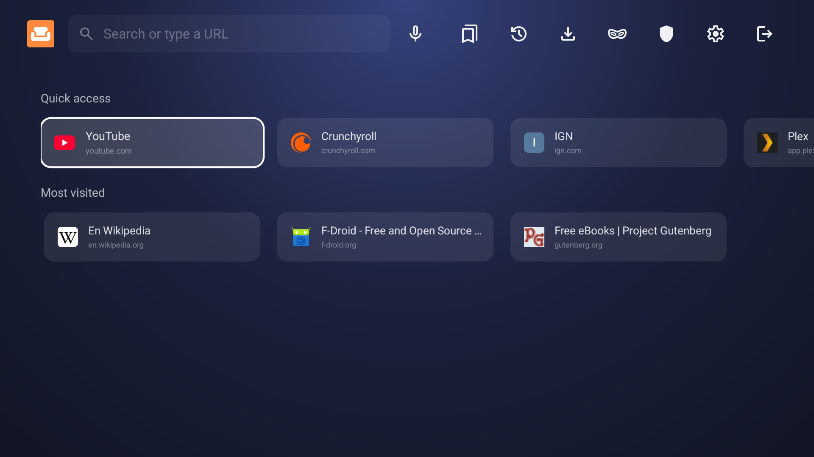

# Sofa TV Browser

A small, private web browser for Android TV and Google TV, made for the remote. On the TV it's simply called Sofa.



Sofa is free and about 2 MB. It has no ads and no tracking, and it blocks other people's ads too.

## What it does

- **Browse with the remote.** The arrows move a pointer, like a mouse, and OK clicks. The Back key opens the menu.
  A game pad works too.
- **Tabs.** Keep up to 10 pages open. Only the one you're looking at runs, so the TV stays quick.
- **Press Play to watch.** Sofa finds the video on the page and plays it full screen, in 4K and HDR when the site
  and the TV have it.
- **No ads, no pop-ups.** Blocked on the TV itself, with lists you can add to.
- **Safer for kids.** Block whole kinds of sites, such as adult or gambling sites, and lock Settings with a PIN.
- **Make it yours.** Arrange the start page and the menu, and put a colour or your own photo behind the start page.
- **Bring your bookmarks** from a computer's browser, and back up your settings to a file.
- **Works with TalkBack.** The TV's screen reader reads Sofa's own screens aloud.

It also has voice search, downloads that keep going in the background, and dark and light themes. You choose the
search engine at first start; Sofa doesn't pick one for you.

The full list, with every setting, is in [Sofa in detail](docs/details.md).

## Install

Download `sofa-<version>.apk` from the [latest release](https://github.com/sonalder-darlene/sofa-tv-browser/releases/latest)
and install it on the TV, with a file manager app for example. Sofa needs Android 7.0 or newer.

If Play Protect says "App blocked to protect your device", choose **More details → Install anyway**. It says that
about any app from a developer it hasn't seen before.

## Updates

Sofa can look for a new version once a day and tell you. It asks at first start, and you can change your mind in
Settings → Updates. Nothing installs without your OK.

If an app store or Obtainium installed Sofa, that store keeps it up to date instead.

## Privacy

Sofa has no accounts, no analytics and no crash reports, and there is no Sofa server. Apart from the sites you
visit, it only connects to things you turn on or ask for, such as search suggestions, update checks or a DNS
service.

- Ads, trackers and third-party cookies are blocked on the TV.
- Pages can't use a camera, a microphone, your location or your files.
- A page you leave goes quiet: no sound, its videos pause, and it can't wander off to another site behind your
  back.
- Private browsing has its own tabs and forgets everything when it ends.
- History is kept for 90 days, or as long as you choose.
- A settings backup is locked with a password you choose (unless you choose none), and never holds your PIN,
  history or cookies.

Everything Sofa contacts, and when: [Privacy](docs/details.md#privacy).

## Blocking

Ad blocking works from the first start. If you want more, one switch in Settings adds EasyList and EasyPrivacy,
and Settings → Filter lists takes any other list (uBlock Origin, Adblock Plus or hosts format). If a site doesn't
work, the Ad block button in the menu turns blocking off for that site only.

Sometimes the pop-up blocker stops a window you wanted, like a "Sign in with…" button. Press **Allow once** in the
menu and it opens.

Three more things are off until you turn them on:

- **Site filters** block whole sites by category: adult, gambling, unsafe downloads and drugs, or a list of your own.
  A link or a redirect can't get around them. The lists are made by other people and miss some sites, so think of
  them as a filter, not a guarantee.
- **Parental PIN** asks for a PIN before anyone opens Settings or turns a blocker off. It protects Sofa, not the
  TV: it can't stop someone from using another app. Forget it and the only way back is clearing Sofa's data in
  the TV's settings, which erases your bookmarks and settings too.
- **Custom DNS** sends the TV's "where is this site?" lookups over an encrypted connection, to a service you
  pick from a list ranked from most to least private.

How each one works: [Ad blocking](docs/details.md#ad-blocking), [Site filters](docs/details.md#site-filters),
[Parental PIN](docs/details.md#parental-pin), [Custom DNS](docs/details.md#custom-dns).

## Video

Press Play on the remote and Sofa plays the page's main video full screen. When it can, it hands the video to its
own player, Sofa Player. That's the one that shows 4K at full resolution and HDR, and lets you pick the quality,
the sound and the subtitles. It remembers your picks for the next videos. When it can't, the site's own player
carries on, and Sofa says why.

In full screen you can seek, pause, change the speed, turn subtitles on, use picture-in-picture, or send the video
to another app on the TV with **Play in…**.

Two things worth knowing:

- Protected videos from streaming services (DRM) usually play in standard definition. Those services keep HD for
  hardware protection, and the web engine on Android TV only has software protection. Sofa can't change that.
- On TVs that offer it, **Match frame rate** (in Settings, experimental) switches the TV to the film's own frame
  rate, such as 24 a second, so it doesn't judder.

More on Sofa Player, 4K and frame rates: [Video](docs/details.md#video).

## Not there yet

Reader mode, typing from a phone, translations, and user scripts (planned: [docs/user-scripts.md](docs/user-scripts.md)).

## Support Sofa

Sofa is free, with no ads and no tracking. If you'd like to help it along, you can donate to one of these
addresses. On the TV, Settings → Support Sofa shows the same codes, to scan with your phone's wallet app.

**Bitcoin (BTC), silent payment**: needs a wallet that pays silent payment addresses.


```
sp1qqglkmsmm6fkxzmnjtzzlyfshur2w80zlmaddvq497lesc569aahekqe9h5fvpjn53yz9hfjgc5f872acxx8pqf2jp8pypl3vth4ten4a3s5p9jrv
```

**Bitcoin Lightning**: a Lightning address, which any Lightning wallet can pay.


```
sonalder@cake.cash
```

**Monero (XMR)**


```
469dA6keA9w9EfensKZJnaZCmqQY4foXedwnN98Sm7QVeJeXTMR7EAU913oPqzFRVJes8uyYQWixm6oqH3i37Vyf1NbomdG
```

**Zcash (ZEC), shielded (Ironwood)**: needs a wallet updated for Zcash's Ironwood upgrade.


```
u1paq3l7dms04sml8r4gp40hdh8wu73hlj70rafmyay23rx2rr6kynx2t0dgge2m6nsu6rcsl4xnhp255t3qv062jfrrw3jx4uygkasts8
```

**Ethereum (ETH)**


```
0xC88455aa2b489Ba83Ed9606EA9627466C37C4D5a
```

## For developers

**Build**

```sh
nix develop -c ./gradlew assembleStandardRelease   # app/build/outputs/apk/standard/release/
nix develop -c ./gradlew testStandardDebugUnitTest testPlayDebugUnitTest lintStandardDebug lintPlayDebug
```

Without Nix, use JDK 17 or newer and an Android SDK with platform 36 and build-tools 36.1.0 in `ANDROID_HOME`.
The project uses AGP 9.4.1, Kotlin 2.4.21 and Gradle 9.8.2. The UI is plain framework views; the
dependencies are `androidx.webkit` and Media3 (ExoPlayer with HLS and DASH) for Sofa Player.

**Two builds**

- `standard` is for GitHub releases, F-Droid and other stores. Its opt-in updater (`app/src/standard/`) stays
  hidden when an app store installed Sofa or when the APK isn't signed with the release key. A fork can point it at
  its own releases with `-Psofa.updateUrl=https://api.github.com/repos/<owner>/<repo>/releases/latest` and
  `-Psofa.releaseCert=<sha-256>`.
- `play` is for Google Play, which forbids apps that update themselves. It has no updater
  (`./gradlew bundlePlayRelease`).

**Signing**

Official APKs are signed with this certificate (SHA-256):

```
74:E2:3F:09:BB:4B:01:16:00:C3:8E:7D:55:5F:B3:89:26:AC:C3:83:50:29:B7:FC:02:E4:84:66:C3:4C:8A:A9
```

Check a download with `apksigner verify --print-certs`. Release builds are reproducible: building a release tag
gives the same APK contents.

To sign your own builds, put a `keystore.properties` with `storeFile`, `storePassword`, `keyAlias` and
`keyPassword` at the repository root (it is gitignored), or set `SOFA_KEYSTORE_FILE`, `SOFA_KEYSTORE_PASSWORD`,
`SOFA_KEY_ALIAS` and `SOFA_KEY_PASSWORD`. Without them, release builds use the debug key.

**Releasing**

1. Set `versionName` and `versionCode` (MAJOR × 10000 + MINOR × 100 + PATCH) in `app/build.gradle.kts`.
2. Add the changes to `CHANGELOG.md` and to `fastlane/metadata/android/en-US/changelogs/<versionCode>.txt`
   (500 characters at most).
3. Commit, tag `v<version>`, and build `assembleStandardRelease` from a clean checkout of the tag. The APK records
   its commit, so it must be built from exactly the tagged one.
4. Push, then attach the APK to a GitHub release as `sofa-<version>.apk`. The updater looks for that name and shows
   the first 700 characters of the release notes.

**Testing**

`nix develop .#emulator` provides `adb` and an Android TV 14 emulator:

```sh
avdmanager create avd -n sofatv -k "system-images;android-34;android-tv;x86" -d tv_1080p
"$ANDROID_HOME/emulator/emulator" -avd sofatv
```

On a TV, turn on network debugging, then run `adb connect <tv-ip>:5555` and `adb install -r <apk>`.
`adb install -i <store package>` makes Sofa look as if a store installed it, which hides the updater.

**Layout**

```
app/src/main/java/app/sofabrowser/   browser/ (pointer, WebView, tabs), screen/ (the main screen's parts),
                                     player/ (Sofa Player), ui/, downloads/, adblock/ (ad blocking, Site filters),
                                     dns/ (Custom DNS), lock/ (parental PIN), data/
app/src/main/java/jp/hazuki/…        the Yuzu Browser filter-rule engine (Apache-2.0, see NOTICE.md)
app/src/standard/                    the updater
app/src/play/                        an empty stand-in for the updater
fastlane/metadata/android/           store listing: descriptions, changelogs, graphics, screenshots
art/                                 SVG sources of the banner and store graphics
tools/                               update-blocklist.sh, and render-art.sh (needs rsvg-convert, oxipng, Inter)
```

## Licence

Sofa TV Browser is free software under the [GNU General Public License v3.0 only](LICENSE) (`GPL-3.0-only`). The
third-party parts (Material Symbols icons, the search engines' icons, the StevenBlack hosts list, HaGeZi's Pop-Up Ads
list, the Yuzu Browser ad-block engine, `androidx.webkit` and AndroidX Media3) are listed in [NOTICE.md](NOTICE.md).

Sofa follows the remote-control design of BrowsHere, TCL's TV browser, but contains none of its code, assets or
text.

**Thanks.** Sofa's filter-rule engine comes from [Yuzu Browser](https://github.com/hazuki0x0/YuzuBrowser) by Hazuki, as
improved in [Fulguris](https://github.com/Slion/Fulguris) (Apache-2.0 parts only). Element hiding by class and id
follows the design of [Brave](https://github.com/brave/adblock-rust) and [uBlock Origin](https://github.com/gorhill/uBlock),
without their code. The lists are the work of [StevenBlack/hosts](https://github.com/StevenBlack/hosts),
[HaGeZi](https://github.com/hagezi/dns-blocklists), [the EasyList authors](https://easylist.to/),
[FMHY](https://github.com/fmhy/FMHYFilterlist) and [the Block List Project](https://github.com/blocklistproject/Lists).
